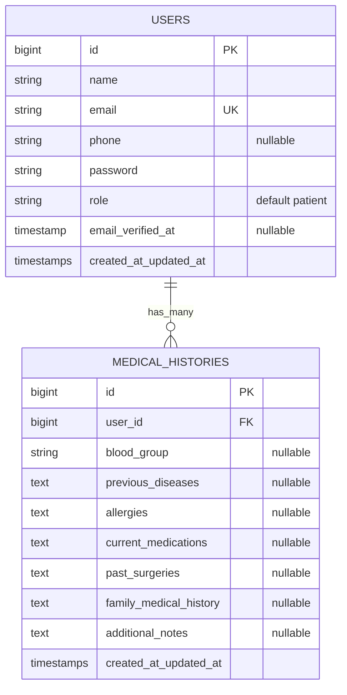

# JotnoHealthcare Database Design

This diagram documents the application tables and relationships visible in the supplied Laravel migrations. It focuses on the domain tables used by the current application; Laravel infrastructure tables are listed separately.

## Entity relationship diagram

## Relationship

- One `users` row can have zero or many `medical_histories` rows.
- Each `medical_histories.user_id` references `users.id`.
- The migration uses `cascadeOnDelete()`, so deleting a user also deletes that user's medical-history rows.
- The `User` model defines `medicalHistories()` as a `HasMany` relationship; `MedicalHistory` defines `user()` as a `BelongsTo` relationship.

## Other framework tables

The migrations also create Laravel support tables: `password_reset_tokens`, `sessions`, `cache`, `cache_locks`, `jobs`, `job_batches`, `failed_jobs`, and `personal_access_tokens`. These support framework sessions, cache, queues, and Sanctum tokens rather than the main patient-healthcare data model.

## Important design observation

The current `medical_histories` table stores health details as nullable text fields. It does not currently contain separate tables for doctors, appointments, consultations, prescriptions, monitoring readings, or notifications. Those should be treated as future modules, not existing database entities.
